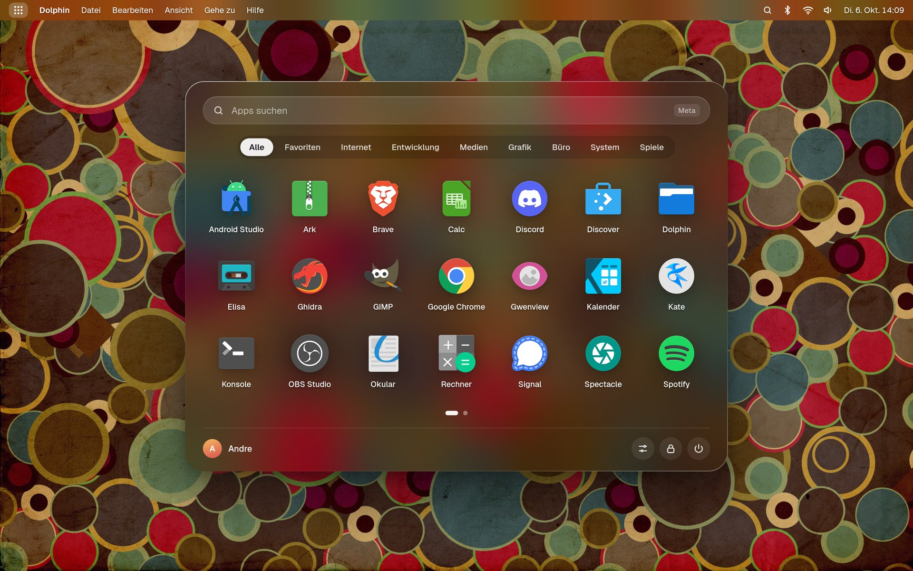

# Glass Launcher

A Launchpad-style application launcher for KDE Plasma 6, built for liquid-glass
effects (e.g. Better Blur with refraction). The launcher is a Plasma dialog with
the theme's background fill removed, so the KWin blur stays visible.



*Design mockup; in the real launcher the glass and icons come from your system.*

## Features

- Paged app grid: swipe with the touchpad (sideways or up/down), use the mouse wheel, or drag
- Search with results ranked by match quality
- Tab bar with "All", "Recent", your own pages and all categories – scrollable, reorder by dragging
- Custom pages: create with "+", rename or delete via right-click; add apps via right-click
- Keyboard: arrow keys, Enter, Tab, Page Up/Down, Esc
- Settings: columns, rows, icon size, glass tint, corner radius, animations

The user interface is currently in German.

## Installation

```bash
git clone https://github.com/logo000/glass-launcher.git
kpackagetool6 --type Plasma/Applet --install glass-launcher
```

Then right-click a panel → "Add Widgets…" → "Glass Launcher".

Update:

```bash
cd glass-launcher && git pull
kpackagetool6 --type Plasma/Applet --upgrade .
systemctl --user restart plasma-plasmashell
```

## Requirements

- KDE Plasma 6 (tested with 6.3)
- For the glass look: a KWin blur effect, e.g. Better Blur

## License

GPL-2.0-or-later
